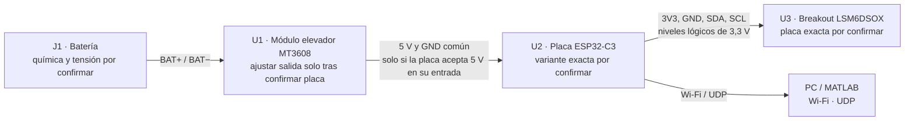

# Esquema inicial de conexiones

## Alcance

Este es el esquema funcional inicial para reconstruir en KiCad la electrónica descrita en el TFM. Define las conexiones entre módulos, no todavía el esquemático de fabricación a nivel de pines y footprints. Los modelos exactos de las placas deben confirmarse antes de fijar pines, tensiones y huellas.

La arquitectura documentada es batería → convertidor elevador MT3608 → placa ESP32-C3; IMU LSM6DSOX por I²C; transmisión inalámbrica por Wi-Fi al PC. La frecuencia de adquisición documentada es 100 Hz y el protocolo de datos es UDP.

## Diagrama funcional

La conexión de alimentación al ESP32 está condicionada a utilizar una placa de desarrollo con entrada de 5 V/VBUS y regulador de 3,3 V. **No conectar la salida de 5 V del MT3608 al pin 3V3 ni directamente al módulo desnudo ESP32-C3-MINI-1.** Si el hardware real es el módulo desnudo, hará falta una alimentación regulada de 3,3 V y un circuito de programación apropiado.

## Redes previstas

| Red | Conexiones funcionales | Estado |
|---|---|---|
| `BAT_RAW+` | Positivo de batería → `VIN+` de MT3608 | Tensión y química de batería por confirmar |
| `GND` | Negativo de batería, `VIN−`/`VOUT−` del MT3608, GND de ESP32 e IMU | Referencia común |
| `SYS_5V` | `VOUT+` MT3608 → entrada `5V`/`VBUS` de la placa ESP32-C3 | Solo tras confirmar que la placa acepta 5 V en esa entrada; ajustar y medir el convertidor antes de conectar |
| `SYS_3V3` | Salida 3,3 V regulada de la placa ESP32 → alimentación del breakout IMU | Confirmar en la ficha del breakout si se conecta a `VIN` o `3V3` |
| `I2C_SDA` | GPIO SDA de ESP32 → SDA del LSM6DSOX | Elegir GPIO al confirmar la variante exacta de la placa |
| `I2C_SCL` | GPIO SCL de ESP32 → SCL del LSM6DSOX | Elegir GPIO al confirmar la variante exacta de la placa |
| `IMU_INT1`, `IMU_INT2` | Salidas de interrupción de IMU | No necesarias para la adquisición inicial por sondeo; dejar sin conectar o reservar pads |

El bus I²C y todas sus señales deben permanecer a nivel lógico de 3,3 V. No añadir pull-ups externos hasta comprobar si el breakout ya los incorpora. El firmware incluido en el TFM usa la dirección I²C `0x6A`; confirmar el strap de dirección del breakout para que coincida. La selección de interfaz I²C/SPI y el estado de pines `CS`/`SDO` dependen de la placa breakout concreta y se fijarán a partir de su documentación.

## Componentes y referencias provisionales

| Ref. | Componente del TFM | Representación en el esquema inicial |
|---|---|---|
| `J1` | Batería, modelo no especificado | Conector de dos vías, polaridad señalizada |
| `U1` | Módulo MT3608 | Módulo con `VIN+`, `VIN−`, `VOUT+`, `VOUT−` |
| `U2` | ESP32-C3 | Placa/módulo con alimentación y GPIO expuestos; variante por confirmar |
| `U3` | Breakout LSM6DSOX | Placa con alimentación, I²C y configuración de interfaz/dirección |
| `J2` | Interfaz ESP32–IMU | Cableado directo o conector; tipo y pinout por confirmar |

El TFM describe el microcontrolador como `ESP32-C3-MINI-1`, mientras que la fotografía muestra una placa de desarrollo USB. Antes de crear footprints o asignar números de pin hay que identificar cuál de los dos se utilizó. La fotografía del breakout sugiere una placa con regulador y pines de alimentación rotulados `VIN`/`3V0`; su fabricante y referencia también deben confirmarse.

## Verificaciones antes de conectar o fabricar

1. Identificar la referencia exacta de la placa ESP32 y localizar sus pines `5V`/`VBUS`, `3V3`, GND y GPIO I²C.
2. Identificar el breakout LSM6DSOX y confirmar tensión admitida, pines de alimentación, pull-ups, dirección y selección I²C.
3. Identificar química, tensión y protección de la batería. El MT3608 es un elevador, no un cargador ni un circuito de protección de batería.
4. Con la batería y los módulos aún desconectados, ajustar y medir `VOUT` del MT3608 conforme a la entrada permitida por la placa ESP32 escogida.
5. Verificar continuidad de GND, polaridad y ausencia de cortocircuitos antes de energizar.
6. Confirmar que la alimentación de la IMU procede de una salida regulada de 3,3 V compatible con el breakout; no conectar la salida ajustable del MT3608 directamente a la IMU.
7. Probar primero la adquisición I²C y la transmisión de datos con la electrónica fuera de la cápsula.

No conectar ni cargar una batería de química desconocida. Este esquema no incluye circuito de carga, protección, interruptor, control del actuador ni conexión a un actuador. Se añadirán únicamente cuando se definan sus componentes y requisitos.

## Pendiente para la versión KiCad

- Confirmar las referencias exactas de ESP32, breakout IMU, batería y módulo MT3608.
- Decidir si el primer diseño será una PCB portadora para módulos existentes o una integración de componentes soldados directamente.
- Obtener dimensiones, pinout y footprints de fabricante.
- Definir conector, interruptor, protección de entrada y puntos de prueba.
- Verificar alimentación, restricciones de antena Wi-Fi, fijación mecánica y envolvente de la cápsula.
- Ejecutar ERC/DRC y revisión eléctrica una vez creado el esquema y asignados los footprints.
