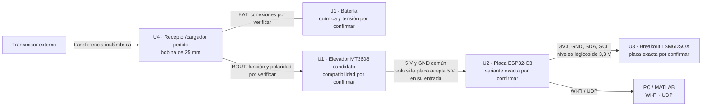

# Esquema inicial de conexiones

## Alcance

Este es el esquema funcional inicial para reconstruir en KiCad la electrónica descrita en el TFM. Define las conexiones entre módulos, no todavía el esquemático de fabricación a nivel de pines y footprints. Los modelos exactos de las placas deben confirmarse antes de fijar pines, tensiones y huellas.

Se diseñará una **PCB portadora para soldar los módulos**, no una integración desde cero de todos sus componentes. En los módulos que no traigan pines se colocarán pines soldados adecuados a sus pads; habrá que comprobar su paso, número, orientación y altura, así como las necesidades de acceso y montaje, antes de elegir las huellas. La posición de cada módulo y el tipo de unión a la PCB se definirán con las piezas reales. Esto no sustituye la identificación de sus conexiones eléctricas ni implica que se vaya a soldar directamente sobre la batería.

La arquitectura del TFM utilizaba batería → convertidor elevador MT3608 → placa ESP32-C3; IMU LSM6DSOX por I²C; transmisión inalámbrica por Wi-Fi al PC. Para el nuevo diseño se ha pedido un receptor/cargador inalámbrico que sustituirá al cargador de batería anterior, cuya referencia no está identificada aquí. El MT3608 es un elevador de tensión, no un cargador: se conserva como candidato para la etapa de alimentación, sujeto a verificación. La frecuencia de adquisición documentada es 100 Hz y el protocolo de datos es UDP.

## Diagrama funcional

La conexión de alimentación al ESP32 está condicionada a utilizar una placa de desarrollo con entrada de 5 V/VBUS y regulador de 3,3 V. **No conectar la salida de 5 V del MT3608 al pin 3V3 ni directamente al módulo desnudo ESP32-C3-MINI-1.** Si el hardware real es el módulo desnudo, hará falta una alimentación regulada de 3,3 V y un circuito de programación apropiado.

La conexión a `BOUT` es una intención de diseño, no un pinout confirmado: hay que verificar si es una salida de carga, sus dos polos, su tensión, corriente, protección y comportamiento durante la carga. Si `BOUT` no es adecuado, se modificará la arquitectura; no se conectará el elevador hasta comprobarlo. Para la PCB se prevé una interfaz de cuatro pines para el receptor/cargador, sin asignar todavía orden ni funciones definitivas.

La disposición física prevista, desde la tapa de carga hacia el extremo lastrado, es **receptor/cargador → boost → IMU → ESP32**. No implica que los módulos estén conectados eléctricamente en serie: el ESP32 se comunica con la IMU por I²C. La distribución y las distancias se comprobarán con las dimensiones, la interferencia y las restricciones de antena reales; véase [Materiales y ensamblajes](MATERIALES_Y_ENSAMBLAJES.md).

En una futura ampliación se prevé situar el actuador y su amplificador o etapa de accionamiento en la punta lastrada. Su tipo, alimentación y señales de control están por definir; no forman parte del circuito inicial ni se ha asignado aún una conexión eléctrica.

## Redes previstas

| Red | Conexiones funcionales | Estado |
|---|---|---|
| `BAT` | Batería ↔ terminales de batería del receptor/cargador | Química, protección, polaridad y tensión por confirmar |
| `BOUT` | Salida prevista del receptor/cargador → entrada del elevador | Función, polaridad, tensión, corriente y comportamiento durante carga por verificar |
| `GND` | Retorno del elevador, GND de ESP32 e IMU | Referencia común de la electrónica; relación con batería y receptor por confirmar, especialmente si hay protección |
| `SYS_5V` | `VOUT+` MT3608 → entrada `5V`/`VBUS` de la placa ESP32-C3 | Solo tras confirmar que la placa acepta 5 V en esa entrada; ajustar y medir el convertidor antes de conectar |
| `SYS_3V3` | Salida 3,3 V regulada de la placa ESP32 → alimentación del breakout IMU | Confirmar en la ficha del breakout si se conecta a `VIN` o `3V3` |
| `I2C_SDA` | GPIO5 → SDA del LSM6DSOX | Usado por el firmware del TFM; confirmar conexiones y placa real |
| `I2C_SCL` | GPIO6 → SCL del LSM6DSOX | Usado por el firmware del TFM; confirmar conexiones y placa real |
| `IMU_INT1`, `IMU_INT2` | Salidas de interrupción de IMU | No necesarias para la adquisición inicial por sondeo; dejar sin conectar o reservar pads |

El bus I²C y todas sus señales deben permanecer a nivel lógico de 3,3 V. No añadir pull-ups externos hasta comprobar si el breakout ya los incorpora. El firmware incluido en el TFM usa la dirección I²C `0x6A`; confirmar el strap de dirección del breakout para que coincida. La selección de interfaz I²C/SPI y el estado de pines `CS`/`SDO` dependen de la placa breakout concreta y se fijarán a partir de su documentación.

## IMU Adafruit LSM6DSOX: referencia para la portadora

El diseño oficial [Adafruit LSM6DSOX, producto 4438](https://github.com/adafruit/Adafruit-LSM6DSOX-PCB) se parece al breakout de la fotografía del montaje del TFM, pero falta confirmar referencia y revisión en la unidad física. Los datos siguientes proceden de su esquema y placa Eagle, revisión Git `c05abef4675b0380fbf3d23171615a2f1ac0b130`:

- Contorno de PCB **25,40 × 17,78 mm**; fila principal de nueve agujeros con paso **2,54 mm** y taladro de **1,00 mm** en el diseño. Hay otra fila de cinco contactos y dos conectores STEMMA QT: dejar espacio para los que se utilicen y su altura.
- Orden eléctrico de la fila principal, del pad 1 al 9: **VIN, 3Vo, GND, SCL, SDA, SDO, CS, INT1, INT2**. Antes de crear la huella, comprobar desde qué cara y extremo se mira y contrastar con la serigrafía de la placa real.
- Para conservar el firmware del TFM: **GPIO5 → SDA**, **GPIO6 → SCL**, y masa común. La alimentación del breakout se decidirá tras verificar la fuente y el módulo real: `VIN` es entrada del regulador de la placa y `3Vo` está conectado a su salida de 3,3 V; no son pines intercambiables por defecto.
- El diseño incorpora resistencias de pull-up y adaptación de nivel en I²C. No añadir pull-ups a la portadora sin revisar las ya presentes, su tensión y el resto del bus. Confirmar configuración de `CS` y `SDO`, dirección `0x6A` y arranque con el breakout real.

Las dimensiones son del contorno de la placa, no de la envolvente completa de conectores, pines y soldaduras. Verificar el montaje, la altura y separación antes de fabricar; no fijar una huella definitiva basándose solo en la fotografía.

## Placa ESP32-C3 mostrada

La imagen facilitada muestra una placa con conector USB y dos filas de ocho contactos. Con el conector USB arriba y en la misma vista de la imagen, las etiquetas de arriba abajo son:

| Fila izquierda | Fila derecha |
|---|---|
| 5V | GPIO5 |
| GND | GPIO6 |
| 3V3 | GPIO7 |
| GPIO4 | GPIO8 (SDA en la imagen) |
| GPIO3 | GPIO9 (SCL en la imagen) |
| GPIO2 | GPIO10 |
| GPIO1 | GPIO20 |
| GPIO0 | GPIO21 |

Es una referencia **provisional** para el esquemático: hay que confirmar que la placa física coincide, su modelo y la vista de montaje antes de numerar pines o asignar una huella. La primera imagen no permite medir paso, separación entre filas, contorno, altura ni zona de antena. El rótulo `5V` no demuestra por sí solo si admite alimentación externa ni cómo interactúa con USB.

Una segunda imagen de dimensiones muestra una placa de **18,00 × 23,50 mm**, con paso entre contactos de **2,54 mm** y conector USB. Sin embargo, parece mostrar **nueve contactos por fila**, frente a los ocho por fila de la primera imagen. No se debe combinar su contorno ni su paso con el pinout anterior como si fueran la misma placa hasta comprobar la unidad real. La altura, la separación entre filas, la posición y altura de la antena y el espacio necesario alrededor del USB también requieren comprobación.

El usuario identifica una tercera imagen como la placa elegida: muestra **17,8 × 22,5 mm** y ocho contactos por fila, con un aspecto compatible con la fotografía de la placa del TFM. Se toman esas dimensiones como referencia inicial, pendientes de medir en la unidad física. Esta vista es de la cara de componentes y la primera muestra la cara opuesta: al contrastar sus filas hay que tener en cuenta el cambio de vista, no trasladar izquierda y derecha directamente. La imagen no acota el paso ni la distancia entre centros de filas; no extrapolar los 2,54 mm de la otra placa.

El usuario confirma que el paso entre pines consecutivos es **2,54 mm**. La separación transversal entre los centros de las dos filas es una cota distinta y permanece pendiente de medición antes de diseñar la huella.

El usuario indica además que la separación entre filas es la misma que en la placa de nueve contactos. En el dibujo de esta última, 18 mm de ancho y 1,38 mm desde un borde al centro del contacto sugieren **15,24 mm entre centros** si el margen del lado opuesto es igual. Es una estimación por simetría, no una cota explícita ni una medida confirmada: comprobarla en la placa seleccionada antes de finalizar la huella o fabricar.

Para el diseño se requiere que los centros de los pines sigan una **cuadrícula de 2,54 mm** en ambas direcciones. La separación propuesta de 15,24 mm equivale a seis pasos y cumple esa condición, pero no es la única separación posible en la cuadrícula: confirmar la medida real antes de fijarla.

La fotografía `imagenes/ESP32-c3.jpg` del TFM muestra ocho contactos por fila y una placa con USB y antena de chip, compatible visualmente con la primera imagen. La fotografía del montaje `imagenes/frente.JPG` muestra una placa de aspecto similar, aunque no permite leer con seguridad todos sus contactos. La imagen acotada de nueve contactos aparentes no permite asegurar que corresponda a esa misma variante. El texto del TFM la denomina ESP32-C3-MINI-1, pero esto no confirma la referencia exacta de la placa ni sus dimensiones. Fuentes: `references/tfm/TFM-densimetro.zip`.

El firmware del TFM (`apendice_ejemplo.tex` en ese archivo) declara `SDA_PIN = 5`, `SCL_PIN = 6` y usa `Wire.begin(SDA_PIN, SCL_PIN)` con dirección `0x6A`. Para conservarlo, se propone **GPIO5 → SDA y GPIO6 → SCL**, no los GPIO8 y GPIO9 sugeridos en la primera imagen. Confirmar la correspondencia física en la unidad, las conexiones y la dirección de la IMU; las etiquetas MISO/MOSI de GPIO5/6 en la imagen no impiden asignarles I²C mediante firmware, siempre que no se utilicen simultáneamente para SPI. GPIO8 y GPIO9 son pines de configuración de arranque y requieren especial cuidado. El pin `3V3` solo se usará para alimentar el breakout si se confirma que su salida, tensión y corriente son compatibles.

## Componentes y referencias provisionales

El usuario indica unas dimensiones de **17 × 36 mm** para el módulo boost MT3608. En la fotografía del montaje del TFM se aprecian contactos rotulados `VIN+`, `VIN−`, `VOUT+` y `VOUT−`. Es necesario confirmar que el módulo a montar corresponde a la fotografía y medir la ubicación y paso de esos contactos y la altura de sus componentes antes de dibujar su huella. La medida del contorno no incluye necesariamente pines ni soldaduras.

| Ref. | Componente del TFM | Representación en el esquema inicial |
|---|---|---|
| `J1` | Batería, modelo no especificado | Conector de dos vías; asignación por verificar |
| `U1` | Módulo MT3608 del TFM | Elevador candidato; confirmar compatibilidad con `BOUT` y placa ESP32 |
| `U2` | ESP32-C3 | Placa/módulo con alimentación y GPIO expuestos; variante por confirmar |
| `U3` | Breakout LSM6DSOX | Placa con alimentación, I²C y configuración de interfaz/dirección |
| `J2` | Interfaz ESP32–IMU | Cableado directo o conector; tipo y pinout por confirmar |
| `U4` | Receptor/cargador inalámbrico pedido | Placa aproximada de 15 × 18 mm y bobina circular de 25 mm; especificaciones eléctricas pendientes |
| `J3` | Interfaz entre `U4` y la PCB principal | Se reservan cuatro pines; funciones y orden pendientes de comprobación |

El TFM describe el microcontrolador como `ESP32-C3-MINI-1`, mientras que la fotografía muestra una placa de desarrollo USB. Antes de crear footprints o asignar números de pin hay que identificar cuál de los dos se utilizó. La fotografía del breakout sugiere una placa con regulador y pines de alimentación rotulados `VIN`/`3V0`; su fabricante y referencia también deben confirmarse.

## Verificaciones antes de conectar o fabricar

1. Identificar la referencia exacta de la placa ESP32 y localizar sus pines `5V`/`VBUS`, `3V3`, GND y GPIO I²C.
2. Identificar el breakout LSM6DSOX y confirmar tensión admitida, pines de alimentación, pull-ups, dirección y selección I²C.
3. Identificar química, tensión y protección de la batería; confirmar compatibilidad y corriente de carga del receptor. El MT3608 no es un cargador ni protege la batería.
4. Confirmar polaridad, tensión y corriente de `BAT` y `BOUT`, protección, límites térmicos y posibilidad de alimentar la carga durante la carga inalámbrica. No puentear ni eludir protecciones de batería.
5. Alimentar el elevador desde una fuente apropiada, con la batería y la electrónica de destino desconectadas, y ajustar y medir `VOUT` conforme a la entrada permitida por la placa ESP32 escogida.
6. Verificar continuidad, polaridad y ausencia de cortocircuitos antes de energizar.
7. Confirmar que la alimentación de la IMU procede de una salida regulada de 3,3 V compatible con el breakout; no conectar la salida ajustable del MT3608 directamente a la IMU.
8. Probar primero la adquisición I²C y la transmisión de datos con la electrónica fuera de la cápsula; evaluar temperatura y seguridad de la carga antes de su uso dentro de la carcasa cerrada.

No conectar ni cargar una batería de química desconocida. El receptor/cargador se ha pedido, pero sus funciones de carga y protección todavía deben verificarse; el esquema no garantiza protección ni gestión simultánea de carga y consumo. No incluye interruptor, control del actuador ni conexión a un actuador.

## Pendiente para la versión KiCad

- Confirmar las referencias exactas de ESP32, breakout IMU, batería y módulo MT3608.
- Confirmar los terminales y características del receptor/cargador recibido y la protección requerida para la batería.
- Definir las uniones y pines de cada módulo a la PCB portadora y la sujeción y conexión segura de la batería.
- Obtener dimensiones, pinout y footprints de fabricante.
- Definir conector, interruptor, protección de entrada y puntos de prueba.
- Verificar alimentación, restricciones de antena Wi-Fi, fijación mecánica y envolvente de la cápsula.
- Ejecutar ERC/DRC y revisión eléctrica una vez creado el esquema y asignados los footprints.
